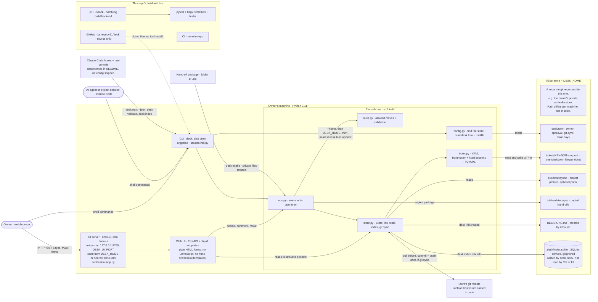
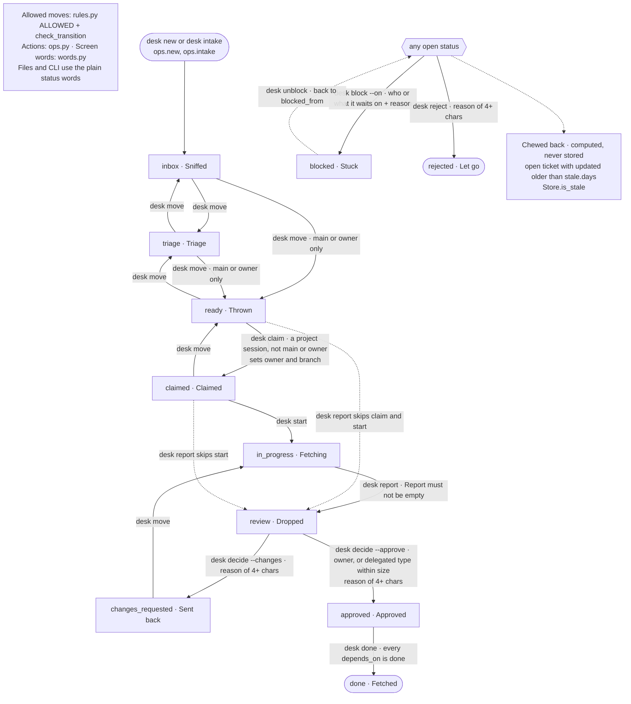
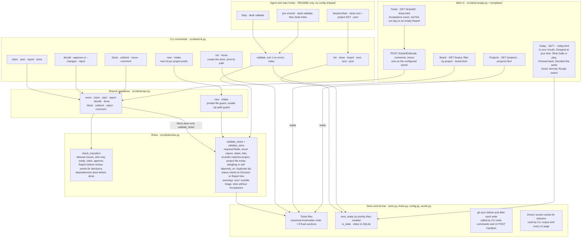

# Desk architecture

A snapshot of what exists in `jameseby21/desk` (branch `main`, commit `0faf4e4`), read on 2026-11-08. Every Mermaid block below also has a `.mmd` source and an `.svg` render in [`architecture/`](architecture/): `infrastructure`, `functionality-lifecycle`, `functionality-surfaces`.

## 1. What Desk does today

Desk is a ticket tracker for one owner and the AI agents that work for him. Each ticket is one Markdown file with a YAML header, kept in a separate folder called the store, which is its own git repository and not part of this repo. The `desk` command (also installed as `drew`, because typing `desk` on Windows opens the Display Settings applet) creates tickets, moves them through a fixed set of statuses, records the owner's approvals in his own words, and checks every file against the rules. `desk-ui` (also `drew-ui`) serves a small web page on the owner's own machine at `127.0.0.1:8765` with Today, Board, Projects and Ticket views, where the owner can approve, send back, move and comment. The command line and the web page call the same Python functions, so the same rules apply to both. When the store's `desk.toml` turns git sync on, each write pulls first and commits and pushes afterwards. `desk index` writes a SQLite copy of the tickets, but nothing in the code reads it yet. There is no hosted server, no external service and no CI. Planned, and described only on the jeby.us Lab page, not in this code: a lesson library, hosted sync across machines, AI-agent seats and proof captured from CI.

## 2. Infrastructure

How the code finds the store (`src/desk/config.py`, `find_home`):

1. The `--home PATH` flag (CLI only).
2. The `DESK_HOME` environment variable. It must point at a folder that contains `desk.toml`, or the command stops with an error.
3. Otherwise, walk up from the current folder to the nearest `desk.toml`.

`desk home` prints the store it resolved. The README tells Windows users to set `DESK_HOME` once as a user environment variable. `desk-ui` uses steps 2 and 3. The owner's real ticket data lives in a private umbrella store outside this repo; its path differs per machine and appears nowhere in the code. `desk init` adds `.desk/` and `jeby-private/` to the store's `.gitignore`, and `desk intake` refuses any package that contains a `PRIVATE_CONTEXT.md` file or a `jeby-private` path.

Unclear or not in this repo:

- unclear: which host the store's git remote lives on. The code only runs `git pull`, `git commit` and `git push` in the store folder.
- The Claude Code hooks (SessionStart, Stop) and the pre-commit hook are described in the README; no hook configuration ships in this repo, and whether a store or project repo has them installed is not visible from here.
- `.desk/index.sqlite` is written by `desk index` but read by nothing in the CLI or UI.

## 3. Functionality

### 3a. Ticket lifecycle

Status names in files and on the command line are the plain words; the web UI and CLI output also show Drew's words (`src/desk/words.py`).

### 3b. Commands, pages and rules

## 4. Tech stack

| Layer | Technology and version | Where it is configured |
| --- | --- | --- |
| Language and runtime | Python, `requires-python >=3.11` | `pyproject.toml`, `uv.lock` |
| Packaging and environments | uv with `uv.lock`; build backend hatchling (unpinned); wheel ships only `src/desk` | `pyproject.toml` `[build-system]`, `[tool.hatch.build.targets.wheel]` |
| Executables | `desk`, `desk-ui`, `drew`, `drew-ui` | `pyproject.toml` `[project.scripts]` |
| CLI | argparse (standard library) | `src/desk/cli.py` |
| Web framework | FastAPI 0.162.2 (Starlette 1.10.0, Pydantic 2.14.3); declared `>=0.115` | `pyproject.toml`, `uv.lock`, `src/desk/ui/app.py` |
| Web server | uvicorn 0.54.0, bound to `127.0.0.1`, port 8765 or `DESK_UI_PORT` | `uv.lock`, `src/desk/ui/app.py` `main()` |
| Templates | Jinja2 3.1.6 (MarkupSafe 3.0.4); plain HTML forms, inline CSS, no JavaScript, no htmx | `src/desk/ui/templates/` |
| Form parsing | python-multipart 0.0.33 | `pyproject.toml`, `uv.lock` |
| Ticket format | YAML frontmatter via PyYAML 6.0.3 + fixed Markdown sections | `src/desk/ticket.py` |
| Store settings | TOML read with `tomllib` (standard library); defaults in code | `desk.toml` in the store; `src/desk/config.py` |
| Search index | SQLite via `sqlite3` (standard library) | `.desk/index.sqlite` in the store; `src/desk/store.py` |
| Sync | git command line via `subprocess` | `[git] sync` in the store's `desk.toml`; `src/desk/store.py` |
| Tests | pytest 9.2.0, httpx 0.28.1 (FastAPI TestClient) | `pyproject.toml` `[dependency-groups] dev`, `[tool.pytest.ini_options]`; `tests/` |
| CI | none in this repo | — |
| License | MIT, JA Insights LLC | `LICENSE` |

## 5. Brand assets in this repo

There are no logo, icon or favicon files in this repo.

| Asset | Path | Format | Light or dark | Where it is shown |
| --- | --- | --- | --- | --- |
| Header mark: a lime "ball" circle (`#C8F03C`, thin ink border) beside the bold word "Desk" | `src/desk/ui/templates/base.html` (`header .mark` CSS and markup) | HTML and CSS, no file | Light only: the UI has one paper-coloured theme and no dark mode | Top left of every UI page, linking to Today |
| Favicon | none | — | — | No favicon is linked or served, so browsers show their default icon |

Nothing rotates between variants. Related, but outside this repo: the Desk project mark `desk.svg` (a lime ball with a check mark on a dark tile) lives in the jeby-us repo and appears on jeby.us and jainsights.com.

## 6. Where this file should live

Recommended path: `docs/ARCHITECTURE.md`, with the diagram sources and renders beside it in `docs/architecture/` (`infrastructure.mmd/.svg`, `functionality-lifecycle.mmd/.svg`, `functionality-surfaces.mmd/.svg`). GitHub renders the inline Mermaid blocks, so the SVGs are a fallback for other viewers.

Why there:

- The repo keeps a flat root (`README.md`, `LICENSE`, `pyproject.toml`, `uv.lock`, `src/`, `tests/`). It has no `docs/` folder, no `CLAUDE.md` or `AGENTS.md`, and no doc-ownership rules. `README.md` is the one document and doubles as the package description (`readme = "README.md"`), so it should stay the entry point. A `docs/` folder keeps seven new files out of the root.

Registration needed:

- Add one line to `README.md`, for example under "Development": `Architecture: [docs/ARCHITECTURE.md](docs/ARCHITECTURE.md)`.
- Nothing else. There is no CI and no documentation check; pytest only collects `tests/`; the wheel only packages `src/desk`, so `docs/` never ships.

Do not put this file inside a Desk store. `desk validate` loads every file in `tickets/` and fails on one without YAML frontmatter, and any `projects/*.md` file becomes a project.

Keep it current by hand when `cli.py`, `ops.py`, `rules.py`, `ui/app.py`, the templates or `pyproject.toml` change; nothing checks it automatically.
